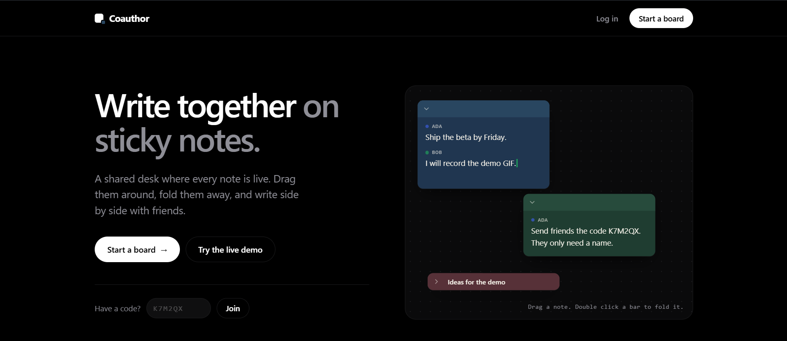

# Coauthor

Write together on sticky notes. Coauthor is a real-time collaborative notes board: every board is a desk of sticky notes that you and your friends can drag around, fold up and write in at the same time, with live cursors and every line labelled with its author.



**Live demo:** https://co-author-app.vercel.app

The backend runs on a free host that sleeps when idle, so the first login or join after a quiet spell can take around 30 seconds while it wakes up.

## What it does

- **Boards of sticky notes.** Drag notes anywhere, fold them up to their title bar, recolor them, give them a title, and add as many as you like.
- **Live editing.** Rich text (bold, italic, underline, strikethrough, lists, headings) that merges cleanly when several people type at once. Everyone gets a colored cursor with a name tag.
- **Every line has an author.** A small name tag appears above each person's text. You can't edit, delete or format someone else's line. You press Enter below it and write your own.
- **Share with a code.** Each board has a six character join code and a link. Guests only need a display name, no account. Owners can switch a board between "let guests in right away" and "I approve each guest", and can generate a new code at any time.
- **Names can't be copied.** The first person to use a name on a board keeps it, so nobody can pose as someone else.
- **Move together, or don't.** Dragging a note moves it on everyone's screen. A switch lets you keep your own layout instead.
- **Works on a phone.** On small screens the board becomes a searchable list of notes, and one note opens full screen.
- **Install it, pop it out.** Coauthor is an installable app (PWA). In Chrome and Edge on desktop you can also pop a single note out into a small always-on-top window, a bit like Windows Sticky Notes.
- **Light and dark.** Follows your system theme.

## Tech stack

| Area | What I used |
| --- | --- |
| Frontend | React, TypeScript, Vite, Tailwind CSS v4, React Router |
| Editor | Tiptap v3 (ProseMirror) with Yjs for shared editing |
| Realtime | Socket.io, Yjs and the Yjs awareness protocol |
| Backend | Node.js, Express, TypeScript |
| Database | MongoDB with Mongoose |
| Auth | JWT, bcrypt, rate limiting on login and register |
| PWA | vite-plugin-pwa |

## How it works

A board is one Yjs document.

- The list of notes lives in a shared map called `notes`. Each entry holds the note's position, color, title and author.
- Each note's text is its own rich text fragment, named `note-<id>`, in the same document.
- The browser sends Yjs updates over Socket.io. The server applies them to its in-memory copy of the document, relays them to everyone else on the board, and saves the document's binary state to MongoDB two seconds after the last edit. When the last person leaves, it saves once more and drops the document from memory.
- Cursors and who is online use the Yjs awareness protocol. They are relayed but never stored.
- If a connection drops, the client reconnects, receives the server's state, and sends back anything it typed while offline. Yjs merges the two without losing either side's edits.

```
 Browser (React, Tiptap, Yjs)  <-- Socket.io -->  Node (Express)  <-->  MongoDB
        |                                              |
        +-- REST: login, register, boards, join code --+
```

### Access control

- The board owner joins with their login token.
- Guests join with the board's join code. If the board is set to approval mode, the guest waits on a screen while the owner gets an Accept or Decline prompt.
- The server decides all of this. Joining a board with a wrong code is refused, and updates from sockets that haven't been let in are ignored.
- Each person has a stable key: their account id if they are logged in, or a random id stored in their browser if they are a guest. The server records which key owns which display name on each board, and refuses a name that belongs to someone else.

### Authorship

Each top level block of text (a paragraph, heading, list and so on) carries the name and color of whoever created it. A small ProseMirror plugin does three jobs: it stamps new blocks with the local user, it rejects any local edit that would change someone else's block, and it draws the name tags. Changes that arrive from other people are never filtered.

## Getting started

You need Node.js 20 or newer and a MongoDB database (a free MongoDB Atlas cluster works, or a local install).

```bash
git clone https://github.com/your-username/coauthor.git
cd coauthor
```

Backend:

```bash
cd backend
cp .env.example .env     # then fill in the values below
npm install
npm run dev
```

Frontend, in a second terminal:

```bash
cd frontend
cp .env.example .env
npm install
npm run dev
```

Open http://localhost:5173.

### Environment variables

`backend/.env`

| Name | What it is |
| --- | --- |
| `PORT` | Port for the API. Defaults to 5000. |
| `MONGO_URI` | MongoDB connection string. Include the database name, for example `.../coauthor`. |
| `JWT_SECRET` | A long random string used to sign login tokens. |
| `CLIENT_URL` | Allowed frontend addresses, separated by commas. Defaults to `http://localhost:5173`. |

`frontend/.env`

| Name | What it is |
| --- | --- |
| `VITE_API_URL` | The API address, ending in `/api`. For example `http://localhost:5000/api`. |
| `VITE_SOCKET_URL` | The socket server address. For example `http://localhost:5000`. |
| `VITE_DEMO_CODE` | Optional. The join code of an open board. When set, the landing page shows a "Try the live demo" button. |

### Testing the install and the pop-out window

The app only registers its service worker in a production build, so to try the install button run:

```bash
cd frontend
npm run build
npm run preview
```

and add `http://localhost:4173` to `CLIENT_URL` in the backend `.env`. The pop-out window needs Chrome or Edge 116 or newer on desktop. Other browsers simply don't show the button.

## Project structure

```
backend/
  src/
    config/        database connection
    controllers/   request handlers (users, boards)
    middleware/    JWT check
    models/        Mongoose models (User, Document)
    routes/        URL to controller wiring
    sockets/       Socket.io server: access checks, sync, persistence
    utils/         join code generator
    index.ts
frontend/
  src/
    components/    Board, NoteWindow, NoteEditor, dialogs, landing page parts
    context/       auth state
    hooks/         collaboration, presence, pop-out window, install prompt
    lib/           API client, board data helpers, authorship plugin
    pages/         landing, login, register, dashboard, editor, join
```

### API

| Method and path | What it does |
| --- | --- |
| `POST /api/users/register` | Create an account. |
| `POST /api/users/login` | Log in and get a token. |
| `GET /api/users/me` | The logged in user. |
| `GET /api/documents` | Your boards. |
| `POST /api/documents` | Create a board. |
| `GET /api/documents/:id` | One of your boards. |
| `PATCH /api/documents/:id` | Rename a board or change its join mode. |
| `DELETE /api/documents/:id` | Delete a board. |
| `POST /api/documents/:id/regenerate-code` | Replace the join code. |
| `GET /api/documents/join/:code` | Public. Look up a board by its code. |

Boards are called documents in the code and the database.

## Deployment

I run the frontend on Vercel, the backend on Render and the database on MongoDB Atlas.

1. **Atlas.** Create a free cluster and a database user. Under Network Access allow connections from anywhere, since a free Render service doesn't have a fixed address.
2. **Render.** Create a Web Service from this repository with the root directory set to `backend`. Build command: `npm install --include=dev && npm run build`. Start command: `npm start`. Health check path: `/api/health`. Add the backend environment variables above, with `CLIENT_URL` set to your Vercel address.
3. **Vercel.** Import the repository with the root directory set to `frontend`. Add `VITE_API_URL` and `VITE_SOCKET_URL` pointing at your Render service. `vercel.json` makes direct links like `/join/ABC123` work.

## Decisions and limits

- **Yjs instead of a custom sync.** Concurrent typing is the hard part of this project, and a CRDT merges edits without a central lock. Writing my own conflict handling would have been a mistake.
- **Authorship is enforced in the editor.** It stops normal use, but someone deliberately tampering with their own browser could bypass it. Enforcing it on the server would mean inspecting every document update.
- **Display names, not accounts, identify guests.** A guest's name is tied to a key in their browser. Clearing site data gives them a new key and a new name.
- **Free hosting sleeps.** The backend wakes on the next request, and the app reconnects and resyncs on its own. The landing page quietly pings the server when it loads, so it is often awake by the time you try to log in.
- **Pop-out windows use the Document Picture-in-Picture API,** which only exists in Chromium based desktop browsers.
- **No automated tests yet.** Everything so far was checked by hand and with small throwaway scripts.

## Roadmap

- Automated tests for the sync and access rules
- Password reset and email verification
- Export a board
- A desktop wrapper (Tauri) for real borderless sticky note windows
- Server side authorship checks

## License

MIT